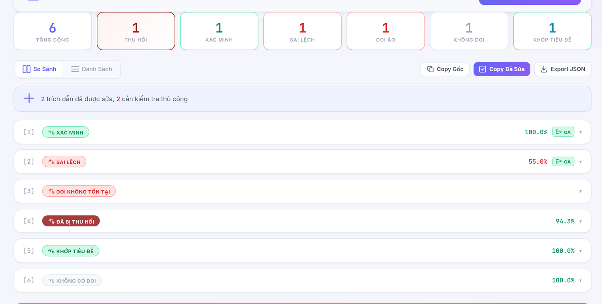
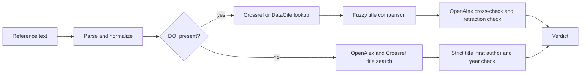
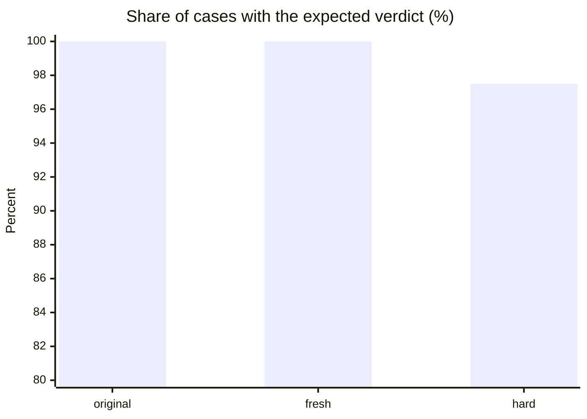

<h1 align="center">CiteGuard</h1>

<p align="center">
  Check every reference in a paper against Crossref, DataCite and OpenAlex.<br>
  Catch fabricated DOIs, retracted papers and citations that point to the wrong work.
</p>

<p align="center">
  <a href="https://github.com/YCN-AFS/Citation-Verifier/actions"></a>
  
  <a href="LICENSE"></a>
</p>

<p align="center">
  <a href="#quick-start">Quick start</a> ·
  <a href="#what-you-get">What you get</a> ·
  <a href="#how-it-works">How it works</a> ·
  <a href="#benchmark">Benchmark</a> ·
  <a href="#configuration">Configuration</a> ·
  <a href="#http-api">HTTP API</a>
</p>

<p align="center">
  <br>
  <sub>The web UI (Vietnamese interface) after checking six references.</sub>
</p>

## What you get

Paste a reference list in almost any format (APA, IEEE, Vancouver, BibTeX, RIS) and every entry gets one of these verdicts:

| Verdict | Meaning | In the screenshot |
|---|---|---|
| `VERIFIED` | The DOI resolves and the title matches the registered record. | [1] |
| `MISMATCH` | The DOI is real but belongs to a different paper. | [2] |
| `DEAD_DOI` | The DOI does not exist in any source. | [3] |
| `RETRACTED` | The paper has been retracted or withdrawn. | [4] |
| `TITLE_MATCHED` | No DOI given, but the title was found and the first author and year are consistent. | [5] |
| `NO_DOI` | No DOI, and no confirmed match by title search. | [6] |
| `SUSPICIOUS` | Partial match (70–89%); worth a manual look. | |
| `API_ERROR` | A source was unreachable or rate-limited, so no verdict is given. Retry later. | |

Beyond verdicts:

- **Side-by-side comparison** of what you cited against what the source says, with one-click copy of corrected references.
- **Cross-check against a second source.** OpenAlex independently confirms Crossref and DataCite results.
- **Background jobs with live progress**, per-browser history, and JSON export for CI.
- **Honest failures.** An unreachable source produces `API_ERROR`, never a false `DEAD_DOI` or `NO_DOI`, and failed lookups are never cached.

## Quick start

```bash
git clone https://github.com/YCN-AFS/Citation-Verifier.git
cd Citation-Verifier
python -m venv .venv && source .venv/bin/activate    # Windows: .venv\Scripts\activate
pip install -r requirements.txt
```

**Web interface**

```bash
python webapp.py        # then open http://localhost:5000
```

**Command line**

```bash
python main.py --file references.txt
python main.py --text "[1]. Author (2020). Title. https://doi.org/10.xxxx"
python main.py --file references.txt --json report.json     # machine-readable report
python main.py --file references.txt --no-cross-validate    # faster, skips the OpenAlex check
```

Example output (abridged):

```text
Ref [1] - VERIFIED
   DOI: 10.1016/j.susc.2014.06.021
   Cited Title: Oxygen and iodine adsorption on cesium-precovered Pt(111). Surface Science
   API Title:   Oxygen and iodine adsorption on cesium-precovered Pt(111) (Crossref)
   Year: ok (cited=2014, actual=2014)
   Cross-validated: confirmed by OpenAlex

Ref [2] - MISMATCH
   DOI: 10.1186/s40663-018-0142-2
   Cited Title: Weakly extendable partial clones on an infinite set. Forest Ecosystems
   API Title:   Young and old forest in the boreal: critical stages of ecosystem dynamics ... (Crossref)
   Scores: ratio=38.6 | token_sort=45.5 | token_set=50.0 -> final=55.0%

Ref [4] - RETRACTED
   DOI: 10.1016/0014-5793(92)81355-p
   Note: This paper has been RETRACTED. It should not be cited in academic work.
```

Production deployment uses PM2: `pm2 start ecosystem.config.js`.

## How it works



- Titles are compared with RapidFuzz (`ratio`, `token_sort_ratio`, `token_set_ratio`) after Unicode and LaTeX normalization; 90% or more is a match.
- A reference without a DOI is accepted only when the title matches strictly **and** the first author and year are consistent with the record.
- Lookups are cached in SQLite and requests share one process-wide throttle, with retries and exponential backoff.

<!-- BENCHMARK:START (generated by benchmark/render_readme.py) -->
## Benchmark

CiteGuard was run against 539 labeled references (509 distinct references) built from real Crossref records, mixing correct citations with fabricated DOIs, mismatched titles, retracted papers and invented references. **536/539 = 99.4%** received the expected verdict, with 0 wrong acceptances and 0 wrong rejections. Measured 2026-10-15 on code version `c66613e`.



| Set | Cases | Expected verdict | Wrong acceptances | Wrong rejections |
|---|---:|---:|---:|---:|
| Original set | 209 | 209 (100.0%) | 0 | 0 |
| Fresh sample (re-drawn from Crossref) | 210 | 210 (100.0%) | 0 | 0 |
| Hard set (no DOI, harder adversaries) | 120 | 117 (97.5%) | 0 | 0 |
| **Total** | **539** | **536 (99.4%)** | **0** | **0** |

A miss means a genuine citation that the tool declined to confirm; it is never a bad citation accepted.

<details>
<summary>Results by case type</summary>

**Original set**

| Case | Expected verdict | Correct |
|---|---|---|
| Correct citation | `VERIFIED` | 30/30 |
| Correct, noisy formatting | `VERIFIED` | 30/30 |
| Real DOI, another paper's title | `MISMATCH` | 29/29 |
| Fabricated DOI | `DEAD_DOI` | 30/30 |
| Retracted paper | `RETRACTED` | 30/30 |
| No DOI, title lookup | `TITLE_MATCHED` | 30/30 |
| Invented title and authors, no DOI | `NO_DOI` | 30/30 |

**Fresh sample (re-drawn from Crossref)**

| Case | Expected verdict | Correct |
|---|---|---|
| Correct citation | `VERIFIED` | 30/30 |
| Correct, noisy formatting | `VERIFIED` | 30/30 |
| Real DOI, another paper's title | `MISMATCH` | 30/30 |
| Fabricated DOI | `DEAD_DOI` | 30/30 |
| Retracted paper | `RETRACTED` | 30/30 |
| No DOI, title lookup | `TITLE_MATCHED` | 30/30 |
| Invented title and authors, no DOI | `NO_DOI` | 30/30 |

**Hard set (no DOI, harder adversaries)**

| Case | Expected verdict | Correct |
|---|---|---|
| Subtitle dropped (genuine) | `TITLE_MATCHED` | 27/30 |
| No DOI, title lookup | `TITLE_MATCHED` | 30/30 |
| Real title, invented authors | `NO_DOI` | 30/30 |
| Title spliced from two papers, real authors | `NO_DOI` | 30/30 |

</details>

**Limitations**

- The sets were generated by the developers from real Crossref records; two title-matching relaxations were written after seeing the failing cases they fix, so results are partly fitted to the data.
- All remaining misses are 'could not confirm' (a genuine citation was not confirmed); there are no wrong acceptances.
- The same 30 retracted papers appear in both the original and fresh sets: 539 evaluations cover 509 distinct references.
- No-DOI cases depend on OpenAlex (run with an API key); if that source is down the outcome is API_ERROR, which is counted as not correct, never as a pass.

To reproduce (network access required; set `OPENALEX_API_KEY`, see [Configuration](#configuration)):

```bash
python benchmark/run_benchmark.py --json /tmp/res_original.json
python benchmark/run_benchmark.py --cases benchmark/cases_seed101.jsonl --json /tmp/res_fresh.json
python benchmark/run_benchmark.py --cases benchmark/cases_hard.jsonl --json /tmp/res_hard.json
python benchmark/make_summary.py original=/tmp/res_original.json fresh=/tmp/res_fresh.json hard=/tmp/res_hard.json
python benchmark/render_readme.py    # regenerate this section
```

The full write-up, including the bugs the benchmark uncovered, is in [`benchmark/RESULTS.md`](benchmark/RESULTS.md). The web UI shows the same numbers, served from `benchmark/summary.json` at `/api/benchmark`.
<!-- BENCHMARK:END -->

## Configuration

Settings are read from environment variables. The application does not load `.env` by itself; export the variables or set them in the `env` block of `ecosystem.config.js`.

| Variable | Purpose |
|---|---|
| `OPENALEX_API_KEY` | Free OpenAlex API key, sent as a Bearer header. Strongly recommended: without it, all requests from one IP share a small daily budget (roughly 100 title searches) and then fail with HTTP 429. |
| `CITEGUARD_MAILTO` | Contact address sent to Crossref and OpenAlex for their polite pools. Default: `citeguard@giize.com`; set your own for your deployment. |

Crossref and DataCite need no key.

## HTTP API

| Endpoint | Description |
|---|---|
| `POST /api/jobs` | Start a verification job; returns a job id. |
| `GET /api/jobs/<id>` | Poll job progress and results. |
| `POST /api/verify` | Synchronous verification for small inputs. |
| `GET /api/history` | List this browser's past sessions (also `GET`/`DELETE` on `/api/history/<id>`). |
| `GET /api/benchmark` | Benchmark results shown in the UI. |
| `GET /api/stats`, `GET /api/health` | Usage counters and health check. |

## Project structure

```
citation_verifier/
  config.py        thresholds, API endpoints, data classes
  parser.py        reference parsing (DOI, title, authors, year)
  normalizer.py    Unicode and LaTeX normalization
  api_clients.py   Crossref, DataCite and OpenAlex clients
  comparator.py    fuzzy matching and title-only confirmation rules
  verifier.py      orchestration
  jobs.py          background verification jobs
  cache.py         SQLite DOI and title cache
  history.py       per-browser verification history
  stats.py         usage counters
  reporter.py      CLI output and JSON report
benchmark/         labeled datasets, runner and results
templates/, static/  web UI
tests/             test suite
main.py            CLI entry point
webapp.py          Flask application
```

## Contributing

1. Fork the repository and create a feature branch.
2. Run `python -m pytest` before opening a pull request.
3. Open a pull request describing the change.

## License

MIT; see [LICENSE](LICENSE).
