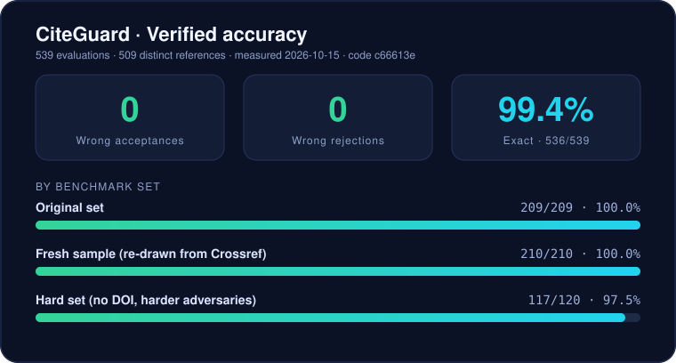

<div align="center">

# CiteGuard

### Automated Academic Citation Verification System

**Cross-reference citations against Crossref, DataCite & OpenAlex — detect fake DOIs, retracted papers, title mismatches, and metadata errors.**

[](https://python.org)
[](LICENSE)
[](https://github.com/rapidfuzz/RapidFuzz)
[](https://flask.palletsprojects.com)

</div>

---

## Features

| Feature | Description |
|---------|-------------|
| **Multi-API Cross-Referencing** | Queries Crossref → DataCite → OpenAlex with automatic routing & fallback |
| **Retraction Detection** | Flags retracted papers via metadata and title-prefix analysis |
| **Conservative Matching** | 90% title threshold, plus author/year evidence for DOI-less matches — **0 wrong acceptances on 539 benchmark cases** ([details](#benchmark)) |
| **Multi-Scorer Fuzzy Matching** | Uses `ratio`, `token_sort_ratio`, and `token_set_ratio` from RapidFuzz (C++ backend) |
| **Title-Based Search** | Handles references without DOIs via OpenAlex & Crossref title search |
| **Cross-Validation** | OpenAlex independently confirms results from Crossref/DataCite |
| **Persistent Cache** | SQLite-backed DOI cache avoids redundant API calls across sessions |
| **Verification History** | Browse, reload, and manage past verification sessions |
| **Live Stats** | Tracks total references verified and usage sessions |
| **Web UI** | Premium light-theme interface with side-by-side comparison view |
| **Copy Corrected** | One-click copy of all corrected references or individual ones |
| **Rich CLI** | Color-coded terminal output with summary dashboard |
| **JSON Export** | Machine-readable report for CI/CD integration |
| **Resilient Networking** | Exponential backoff retry, rate-limit handling (HTTP 429), connection pooling |

## Architecture

```
┌─────────────────────────────────────────────────────────────────────┐
│                           CiteGuard                                 │
├─────────────────────────────────────────────────────────────────────┤
│                                                                     │
│  ┌──────────┐    ┌──────────────┐    ┌────────────────────────────┐ │
│  │  Parser   │───▶│  API Router  │───▶│  Crossref / DataCite /    │ │
│  │ (Regex)   │    │  (DOI-based) │    │  OpenAlex (REST APIs)     │ │
│  └──────────┘    └──────────────┘    └────────────────────────────┘ │
│       │                                          │                  │
│       ▼                                          ▼                  │
│  ┌──────────┐    ┌──────────────┐    ┌────────────────────────────┐ │
│  │Normalizer│───▶│  Comparator  │───▶│  Verdict Engine            │ │
│  │ (Unicode) │    │ (RapidFuzz)  │    │  (≥90% → VERIFIED)        │ │
│  └──────────┘    └──────────────┘    └────────────────────────────┘ │
│                                                  │                  │
│                         ┌────────────────────────┤                  │
│                         ▼                        ▼                  │
│                  ┌──────────────┐          ┌───────────┐            │
│                  │ SQLite Cache │          │ Retraction│            │
│                  │ + History    │          │ Detector  │            │
│                  └──────────────┘          └───────────┘            │
│                         │                        │                  │
│                  ┌──────┴──────┐                  │                  │
│                  ▼             ▼                  ▼                  │
│            ┌──────────┐ ┌───────────┐      ┌───────────┐           │
│            │ Rich CLI │ │  Web UI   │      │   Stats   │           │
│            │ (stdout) │ │  (Flask)  │      │  Counter  │           │
│            └──────────┘ └───────────┘      └───────────┘           │
└─────────────────────────────────────────────────────────────────────┘
```

## Quick Start

### 1. Clone & Setup

```bash
git clone https://github.com/YCN-AFS/Citation-Verifier.git
cd Citation-Verifier

# Create virtual environment
python -m venv .venv
source .venv/bin/activate  # Linux/macOS
# .venv\Scripts\activate   # Windows

# Install dependencies
pip install -r requirements.txt
```

### 2. Web Interface (Recommended)

```bash
python webapp.py
# Open http://localhost:5000
```

### 3. Command Line

```bash
# From file
python main.py --file references.txt

# Direct text
python main.py --text "[1]. Author (2020). Title. https://doi.org/10.xxxx"

# With JSON export
python main.py --file references.txt --json report.json

# Disable cross-validation (faster)
python main.py --file references.txt --no-cross-validate
```

### 4. Production (PM2)

```bash
pm2 start ecosystem.config.js
```

<!-- BENCHMARK:START (generated by benchmark/render_readme.py) -->
## Benchmark

<p align="center"></p>

   

Measured on labeled references built from real Crossref records (`benchmark/`) — 2026-10-15, code version `c66613e`. **536/539 = 99.4%** matched the expected verdict (509 distinct references). A miss is a genuine citation the tool declined to confirm, never a wrong acceptance.

<details open><summary><b>Original set</b> — 209/209 (100.0%)</summary>

| Case | Expected verdict | Correct | |
|---|---|---|---|
| Correct citation | `VERIFIED` | 30/30 | `████████████████████` ✅ |
| Correct, noisy formatting | `VERIFIED` | 30/30 | `████████████████████` ✅ |
| Real DOI, another paper's title | `MISMATCH` | 29/29 | `████████████████████` ✅ |
| Fabricated DOI | `DEAD_DOI` | 30/30 | `████████████████████` ✅ |
| Retracted paper | `RETRACTED` | 30/30 | `████████████████████` ✅ |
| No DOI, title lookup | `TITLE_MATCHED` | 30/30 | `████████████████████` ✅ |
| Invented title and authors, no DOI | `NO_DOI` | 30/30 | `████████████████████` ✅ |

</details>

<details open><summary><b>Fresh sample (re-drawn from Crossref)</b> — 210/210 (100.0%)</summary>

| Case | Expected verdict | Correct | |
|---|---|---|---|
| Correct citation | `VERIFIED` | 30/30 | `████████████████████` ✅ |
| Correct, noisy formatting | `VERIFIED` | 30/30 | `████████████████████` ✅ |
| Real DOI, another paper's title | `MISMATCH` | 30/30 | `████████████████████` ✅ |
| Fabricated DOI | `DEAD_DOI` | 30/30 | `████████████████████` ✅ |
| Retracted paper | `RETRACTED` | 30/30 | `████████████████████` ✅ |
| No DOI, title lookup | `TITLE_MATCHED` | 30/30 | `████████████████████` ✅ |
| Invented title and authors, no DOI | `NO_DOI` | 30/30 | `████████████████████` ✅ |

</details>

<details open><summary><b>Hard set (no DOI, harder adversaries)</b> — 117/120 (97.5%)</summary>

| Case | Expected verdict | Correct | |
|---|---|---|---|
| Subtitle dropped (genuine) | `TITLE_MATCHED` | 27/30 | `██████████████████░░` ⚠️ |
| No DOI, title lookup | `TITLE_MATCHED` | 30/30 | `████████████████████` ✅ |
| Real title, invented authors | `NO_DOI` | 30/30 | `████████████████████` ✅ |
| Title spliced from two papers, real authors | `NO_DOI` | 30/30 | `████████████████████` ✅ |

</details>

**Caveats**

- The sets were generated by the developers from real Crossref records; two title-matching relaxations were written after seeing the failing cases they fix, so results are partly fitted to the data.
- All remaining misses are 'could not confirm' (a genuine citation was not confirmed); there are no wrong acceptances.
- The same 30 retracted papers appear in both the original and fresh sets: 539 evaluations cover 509 distinct references.
- No-DOI cases depend on OpenAlex (run with an API key); if that source is down the outcome is API_ERROR, which is counted as not correct, never as a pass.

Reproduce (needs network; `OPENALEX_API_KEY` recommended, see `.env.example`):

```bash
python benchmark/run_benchmark.py --json /tmp/res_original.json
python benchmark/run_benchmark.py --cases benchmark/cases_seed101.jsonl --json /tmp/res_fresh.json
python benchmark/run_benchmark.py --cases benchmark/cases_hard.jsonl --json /tmp/res_hard.json
python benchmark/make_summary.py original=/tmp/res_original.json fresh=/tmp/res_fresh.json hard=/tmp/res_hard.json
python benchmark/render_readme.py          # refresh README block + docs/benchmark.svg
```

Full write-up, including the bugs the benchmark found: [`benchmark/RESULTS.md`](benchmark/RESULTS.md). The same numbers are shown in the web UI (served from `benchmark/summary.json` at `/api/benchmark`).
<!-- BENCHMARK:END -->

## Verdict System

| Verdict | Threshold | Meaning |
|---------|-----------|---------|
| **VERIFIED** | ≥ 90% | Citation matches API data with high confidence |
| **SUSPICIOUS** | 70–89% | Partial match — manual review recommended |
| **MISMATCH** | < 70% | DOI resolves to a different paper |
| **DEAD DOI** | — | DOI not found in any API |
| **RETRACTED** | — | Paper has been retracted or withdrawn |
| **TITLE MATCHED** | ≥ 90% | No DOI, but title found via search |
| **NO DOI** | — | No DOI and title search inconclusive |

## Project Structure

```
Citation-Verifier/
├── citation_verifier/          # Core verification engine
│   ├── __init__.py
│   ├── config.py               # Thresholds, API endpoints, data classes
│   ├── parser.py               # Reference text parser (DOI, title, year)
│   ├── normalizer.py           # Unicode & LaTeX normalization
│   ├── api_clients.py          # Crossref, DataCite, OpenAlex clients
│   ├── comparator.py           # Multi-scorer fuzzy matching engine
│   ├── verifier.py             # Core orchestrator
│   ├── reporter.py             # Rich CLI output & JSON generator
│   ├── cache.py                # SQLite persistent DOI cache
│   ├── history.py              # Verification session history
│   └── stats.py                # Usage statistics tracker
├── templates/
│   └── index.html              # Web UI template
├── static/
│   ├── style.css               # Light theme styles
│   ├── app.js                  # Frontend logic & inline icon set
│   ├── favicon.svg             # SVG favicon (pulse-quote motif)
│   ├── favicon.png             # PNG favicon fallback (32×32)
│   └── apple-touch-icon.png    # iOS home screen icon (180×180)
├── data/                       # Runtime databases (gitignored)
├── main.py                     # CLI entry point
├── webapp.py                   # Flask web server
├── ecosystem.config.js         # PM2 production config
├── requirements.txt            # Python dependencies
└── test_references.txt         # Sample test data
```

## Dependencies

| Package | Purpose |
|---------|---------|
| `requests` | HTTP client for API calls |
| `rapidfuzz` | High-performance fuzzy string matching (C++ backend) |
| `rich` | Beautiful terminal output |
| `flask` | Web UI server |

## APIs Used

| API | Purpose | Rate Limit |
|-----|---------|------------|
| [Crossref](https://api.crossref.org) | Journal/conference DOI resolution | Polite pool (with mailto) |
| [DataCite](https://api.datacite.org) | arXiv/preprint DOI resolution | Public |
| [OpenAlex](https://api.openalex.org) | Cross-validation & title search | Polite pool (with mailto) |

> No API keys required. The system uses the polite pools of Crossref and OpenAlex for better rate limits.

## Contributing

1. Fork the repository
2. Create your feature branch (`git checkout -b feature/amazing-feature`)
3. Commit your changes (`git commit -m 'Add amazing feature'`)
4. Push to the branch (`git push origin feature/amazing-feature`)
5. Open a Pull Request

## License

This project is licensed under the MIT License — see the [LICENSE](LICENSE) file for details.

---

<div align="center">

**Built with care for academic integrity — CiteGuard v1.2**

</div>
